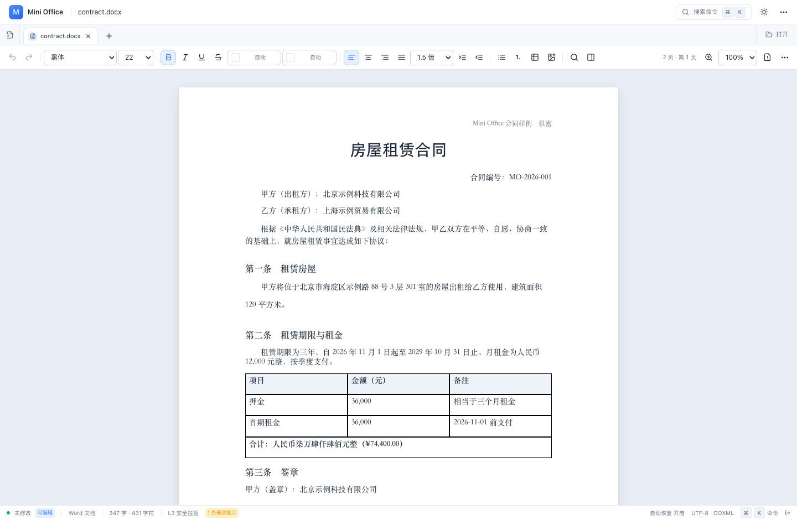
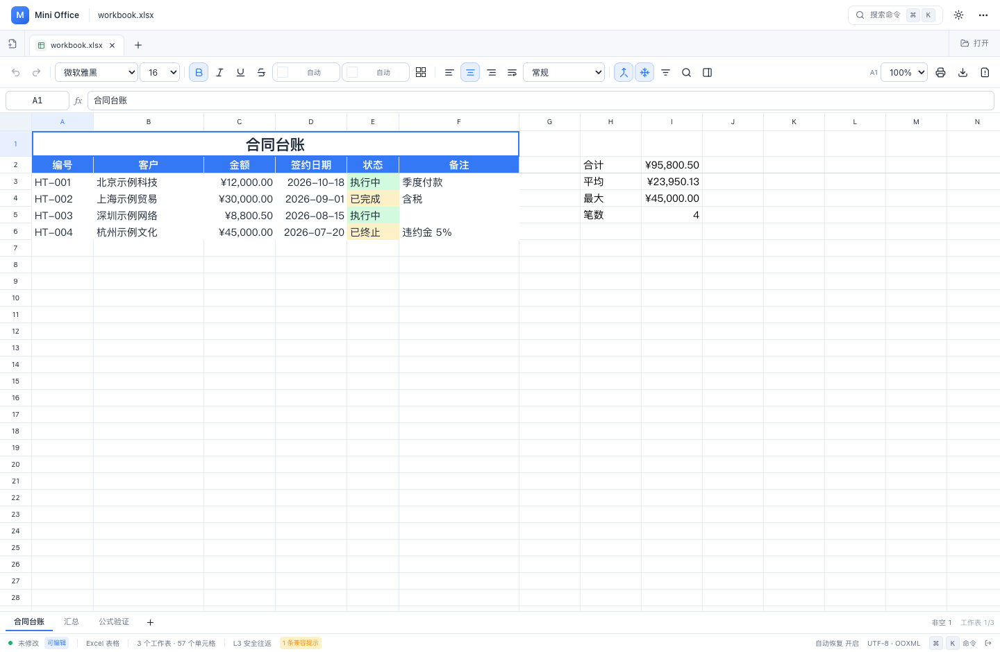
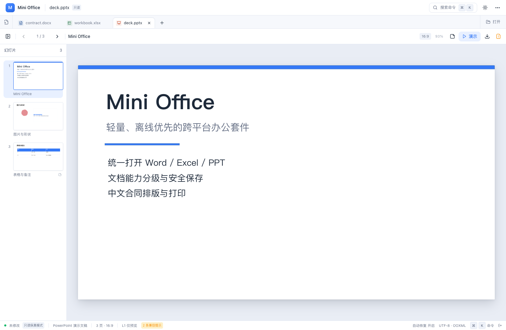

# Mini Office

<!-- 功能：同步当前版本、功能范围与发布限制；时间：2026-10-24；作者：lq。 -->

当前源码版本：**0.1.4** · [版本说明](docs/releases/v0.1.4.md)

> 轻量、离线优先的跨平台办公套件。只保留真正需要的 Office 功能。

Mini Office 是一个基于 **Rust + Tauri 2 + React + TypeScript** 的桌面办公应用，统一支持
Microsoft Word（DOCX）、Excel（XLSX/CSV）与 PowerPoint（PPTX）三类文件。
它把“真实文件兼容”和“文档安全”放在功能数量之前：打开文件时先做能力扫描，
可编辑性与保存策略按 L0–L3 分级，未知 OOXML 部件不会被静默删除。


## 已实现能力

| 模块 | 能力 |
|---|---|
| 统一桌面壳 | 多文件标签页、最近文件、命令面板（⌘/Ctrl+K）、混合 Office 标签、拖拽打开、窗口拖动/双击最大化、主题（浅色/深色/跟随系统）、5 套主题色 + 自定义取色、macOS 原生毛玻璃开关、自动恢复、关闭前保存确认、后台任务状态、Portal 浮层与悬停提示 |
| Word | DOCX 解析与分页渲染、A4/自定义页面、页边距、页眉页脚、页码域、字体/字号/颜色/加粗/斜体/下划线/删除线、对齐/缩进/行距、表格（含合并单元格）、图片、分页符、查找替换、属性面板、打印、PDF 导出、DOCX 保存（复制原件未修改部件） |
| Excel | XLSX/CSV 打开、虚拟滚动网格、单元格编辑、公式栏点选/拖选引用、行列增删/宽高调整、单元格格式弹窗与边框预设、图片插入/拖动/缩放/删除、合并、冻结窗格、工作表原位改名与标签颜色、自定义单字段排序、多列筛选、查找替换、复制粘贴、撤销重做、填充柄、A4 横向打印、PDF 导出、XLSX/CSV 保存 |
| Excel 公式 | 相对/绝对引用、区域、跨表引用、循环引用检测、错误值传播、增量式记忆化重算；`SUM`、`AVERAGE`、`COUNT`、`COUNTA`、`MAX`、`MIN`、`ROUND`、`SUMIF(S)`、`COUNTIF(S)`、`AVERAGEIF(S)`、`IF`、`IFS`、`IFERROR`、`AND`、`OR`、`VLOOKUP`、`XLOOKUP`、`INDEX`、`MATCH`、`LEFT/RIGHT/MID/LEN`、`CONCAT`、`TRIM`、`TODAY/NOW/DATE/YEAR/MONTH/DAY` 等 60+ 函数 |
| PowerPoint | PPTX 母版/版式继承、主题色、形状、文本框/形状文字编辑、图片/表格/组合、对象移动与键盘缩放、备注、页面增删复制、左侧缩略图、16:9/4:3、系统级全屏演示（浏览器 Fullscreen API / Tauri 原生全屏；方向键/空格/Home/End/Esc/N）、PDF 与图片 ZIP 导出、L2 安全另存 |
| 兼容与安全 | OOXML 包扫描、宏/数字签名/外部链接/压缩炸弹检查、L0–L3 能力报告、只读/另存副本策略、保存前验证、原子写入、原件时间戳备份、原生打印 |
| 中文字体 | 系统字体枚举（Web Canvas 探测 / Rust `ttf-parser` + 字体目录扫描）、缺失字体提示与替代字体栈、跨平台字体矩阵说明 |

Word 支持[表格结构编辑](docs/word-table-editing.md)、[页眉页脚与页码设置](docs/word-header-footer.md)，以及[邮件合并与批量报告](docs/word-mail-merge.md)：导入 Excel/CSV、插入模板字段、筛选勾选、逐份预览、批量打印及 DOCX/PDF 输出。

### 界面预览

| Word | Excel |
|---|---|
|  |  |

| PowerPoint | 命令面板 |
|---|---|
|  |  |

## 快速开始

### 环境要求

- Node.js ≥ 20（开发使用 Node 22）
- pnpm ≥ 9（开发使用 pnpm 10）
- Rust ≥ 1.80（开发使用 1.95）
- macOS：Xcode Command Line Tools；Windows：MSVC Build Tools；Linux：WebKitGTK / GTK 依赖

### Web 开发模式

```bash
pnpm install
pnpm dev            # http://127.0.0.1:1420
```

Web 模式使用浏览器文件选择、下载保存与 IndexedDB 自动恢复，可用于快速预览与 UI 调试。

### Tauri 桌面开发 / 构建

```bash
pnpm tauri:dev
pnpm tauri:build
```

桌面模式通过 `PlatformAdapter` 调用 Tauri 命令完成文件读写、字体枚举与路径选择；
前端业务组件不直接依赖 Tauri API。

macOS 窗口在 `tauri.macos.conf.json` 中设为透明，用于可选的原生毛玻璃效果：
`tauri.conf.json` 启用 `macOSPrivateApi`，权限声明 `core:window:allow-set-effects`，
前端通过 `Window.setEffects({ effects: [Effect.UnderWindowBackground] })` 应用 `NSVisualEffectView` 磨砂材质。
该私有 API 能力不适合以 Mac App Store 沙盒审核为目标的发行方式。

### 验证

```bash
pnpm typecheck      # TypeScript 严格类型检查
pnpm test           # Vitest：公式、XLSX 往返、真实 Office 样例
pnpm build          # Web 生产构建
cargo test --workspace
pnpm --filter @mini-office/desktop exec tauri build --debug --bundles app
```

验证范围与记录：

- 当前源码的检查结果见 [0.1.4 版本说明](docs/releases/v0.1.4.md)；测试覆盖公式、格式、筛选、图片、工作表操作、OOXML 往返与发布准备逻辑。
- 已有 DOCX/XLSX/PPTX 样例、PDF/图片 ZIP 导出及浏览器交互验证记录见 [测试说明](docs/testing.md)。
- 自动检查与 Web 构建不能代替桌面安装、Microsoft Office 回读、物理打印和 Windows/Linux 实机验收。
- macOS 原生毛玻璃、打印面板与文件关联仍需在目标设备验证。

### 安装包与发布

已提供手动触发的 macOS / Windows GitHub Actions：读取源码版本，自动准备标签和 Release 草稿，再上传安装包与 SHA256 校验清单。
macOS 提供 Universal（Intel + Apple Silicon）和独立 arm64 包，Windows 提供 x64 NSIS 安装包与 ZIP；流程不会自动公开草稿。
操作步骤及签名限制见 [发布打包说明](docs/macos-release-workflow.md)。源码版本更新不代表安装包已构建或发布。

### macOS 默认文档打开

已接入文档关联和访达文件打开事件，并为原生关窗/Cmd+Q 添加逐份保存确认。默认应用需要用户在访达“显示简介 → 打开方式 → 全部更改”中设置，无需付费开发者证书。无证书不免除首次启动的系统安全检查。

本轮实现、构建证据及待验收范围见 [macOS 文档关联与安全退出](docs/macos-file-associations.md)。

关于页显示“非人类程序员出品”，正式图标已统一接入；Word 支持跨段、跨页选择和正文全选。验证记录见 [Word 选区与品牌更新](docs/word-selection-and-brand.md)。

## 功能完成情况

完整的功能完成度、设计任务映射与发布门槛见 [实施完成度总表](docs/implementation-status.md)。

- **V1 核心功能开发完成**：桌面壳、Word 编辑/保存、Excel 编辑/公式、PPTX 预览/系统全屏演示、安全保存与导出。
- **进行中**：三平台发布工程、Windows/Linux 实机验收、macOS 原生毛玻璃/打印/拖拽实机验收、视觉回归 CI、复杂 OOXML 兼容深化。

## 工程结构

```text
mini-office/
├── apps/desktop/                 # React + Vite + Tauri 2 桌面应用
│   ├── src/                      # 应用入口
│   └── src-tauri/                # Tauri 配置、命令、能力声明
├── packages/
│   ├── design-system/            # Design Token、字体栈
│   ├── ui/                       # Button/Dialog/Menu/Toast 等组件
│   ├── document-model/           # 三大文档模型、生命周期、Zustand 工作区
│   ├── platform-adapter/         # Web / Tauri 平台抽象、IndexedDB 快照、字体探测
│   ├── ooxml/                    # ZIP/XML/关系/能力扫描/单位/颜色
│   ├── editor-shell/             # 首页、标签、命令面板、设置、兼容性对话框
│   ├── editor-word/              # DOCX 解析、分页、编辑、序列化
│   ├── editor-sheet/              # XLSX/CSV 解析、网格、公式引擎、序列化
│   ├── editor-slides/            # PPTX 解析、高保真渲染、演示
│   └── export-service/           # PDF / 图片 ZIP 导出
├── crates/
│   ├── office-core/              # 核心类型、错误、能力等级
│   ├── office-security/          # 压缩包安全扫描与路径策略
│   ├── office-ooxml/             # OOXML 包检测、关系、能力分析
│   ├── office-storage/           # 原子写入、备份、SQLite 最近文件、恢复快照
│   ├── office-font/              # 系统字体枚举与中文识别
│   ├── office-pdf/               # LibreOffice Headless PoC 后端
│   ├── office-doc/sheet/slides/  # 格式适配器
│   └── office-platform/          # 应用目录、平台信息
├── tests/                        # Vitest 回归与真实 Office 样例
├── docs/                         # 架构、UI、兼容矩阵、ADR、截图
└── Cargo.toml / pnpm-workspace.yaml
```

## 文档索引

- [0.1.4 版本说明](docs/releases/v0.1.4.md)
- [macOS / Windows 发布打包说明](docs/macos-release-workflow.md)
- [产品与技术设计（原始 PRD）](docs/prd.md)
- [架构说明](docs/architecture.md)
- [UI 设计规范](docs/ui-design.md)
- [兼容性矩阵](docs/compatibility-matrix.md)
- [里程碑与验收](docs/milestones.md)
- [实施完成度总表](docs/implementation-status.md)
- [测试说明](docs/testing.md)
- [ADR 0001：编辑引擎选型](docs/adr/0001-engine-selection.md)
- [ADR 0002：安全保存策略](docs/adr/0002-safe-save-strategy.md)
- [ADR 0003：公式引擎](docs/adr/0003-formula-engine.md)
- [ADR 0004：PDF 导出策略](docs/adr/0004-pdf-strategy.md)

## 安全保存与兼容分级

| 等级 | 含义 | 行为 |
|---|---|---|
| L0 | 无法打开 | 明确报错，不写入任何文件 |
| L1 | 可预览 | 只读模式；复杂或受保护文件保留原部件 |
| L2 | 可编辑但需另存 | 编辑可用；首次保存强制另存副本，避免覆盖含修订/批注/图表/透视表等原件 |
| L3 | 可验证安全往返 | 允许保存；保存前校验容器，写入临时文件并原子替换，同时备份原件 |

保存流程：

```text
原始文件 → 安全扫描 → 能力报告 → 内部模型/保真模型 → 编辑
        → 兼容性检查 → 临时文件写入 → 容器校验 → 原子替换 → 原件备份
```

## 已知限制（0.1.4）

- PPTX 支持文本框/形状文字、表格文字、对象移动、页面增删复制、演讲者备注和新建演示；编辑文件首次保存为副本。母版装饰、图表、动画和媒体保留原部件，复杂效果需在 PowerPoint 中复核。
- DOCX 修订、批注、内容控件和嵌入对象不提供专用编辑。修订显示插入内容、内容控件按文本读取，批注不显示批注面板、嵌入对象不渲染；原始部件保留，含这些特性的文档保存时强制另存副本，仍需在 Word 中复核锚点与版式。
- XLSX 的图表、透视表、条件格式、外部链接会保留原始包部件，但 V1 不渲染/不刷新；
  条件格式会在兼容性报告中提示。浮动图片支持常用位图与基础定位，复杂绘图效果仍需在 Excel 中复核；CSV 不保存格式、图片或多个工作表。
- 公式覆盖 60+ 常用函数，不包含 VBA、数组溢出、动态数组、Power Query 等高级能力。
- 打印与 PDF 使用浏览器/WebView 渲染（html2canvas + jsPDF），不是排版引擎级 PDF；
  复杂字体与跨平台分页仍需持续回归。
- `office-pdf` 的 LibreOffice 转换仅作为 PoC 对照后端，正式导出不依赖外部安装。
- Tauri 文件 IPC 在 V1 使用 JSON 字节数组传输，超大文件仍有优化空间（后续可改为原始响应/流式分块）。
- 已有 macOS / Windows 安装包工作流；macOS 使用临时签名（ad-hoc），尚无 Developer ID 签名及 Apple 公证，Windows 签名与自动更新也未完成。完整发布门槛仍见 RELEASE-001。
- 原生毛玻璃依赖 macOS 私有 API（`macOSPrivateApi` + `setEffects`），不适合 Mac App Store 沙盒发行；当前只完成构建级验证，仍需 macOS 实机视觉验收。
- Tauri 当前 `csp: null`，生产发布前需要收紧 CSP；Windows/Linux 实机尚未验收。

## 许可

仓库许可证见 [LICENSE](LICENSE)（Apache-2.0）。第三方依赖的许可证需在正式分发前单独审核；设计文档中提到的 ONLYOFFICE、Univer、LibreOffice
等候选引擎未被直接嵌入分发。
