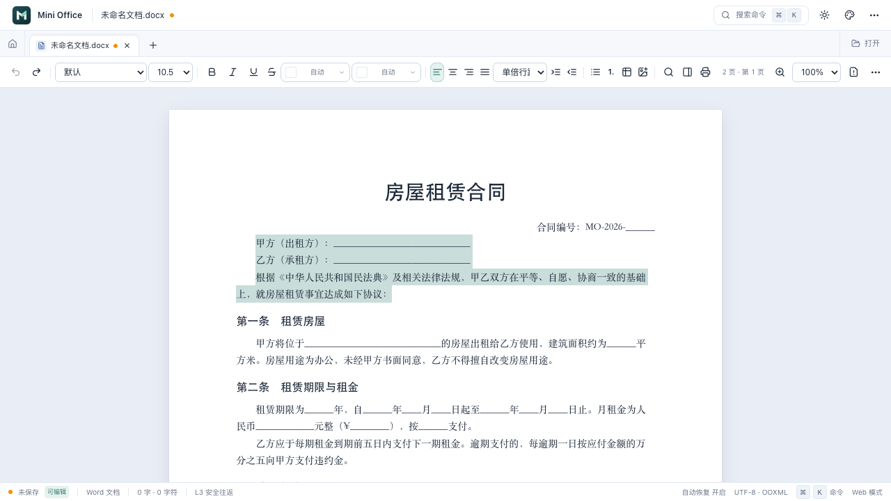
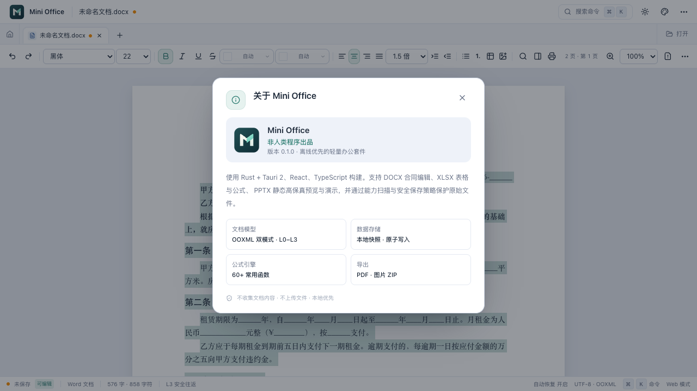

# Word 多段选区修复与品牌图标

> 功能：关于页出品方、Word 选区和正式应用图标；时间：2026-10-18；作者：lq。

## 修改

- 关于页显示“非人类程序出品”，更新为正式图标，公式数量文案同步为 60+。
- 原先每段各自 `contentEditable` 导致原生选区被单段编辑宿主隔离。改为一个共享正文编辑宿主，并明确启用 WebKit 的文本选择。
- Cmd/Ctrl+A 只选择正文，支持跨段、跨页；页眉页脚保留只读。
- 跨段替换、删除、剪切在模型层完成，保护分页容器；整篇替换保留页面设置，同表格不同单元格的部分替换保留表格结构。
- 复制同时提供正文纯文本和保留 run 样式的 HTML，不复制分页界面容器。
- 同步修复共享宿主的 input 事件路由、选区期间失焦分页和格式应用；撤销可恢复整篇正文。
- Logo Designer 工作流设计“折页 M”矢量图，应用到首页、标题栏、启动页、关于、favicon、PNG/ICO/ICNS。设计源和方向见 [品牌设计记录](brand/design-notes.md)。

## 本轮验证

- 类型检查通过；前端共 69 项 / 11 文件通过，本轮新增 7 项 Word 选区测试。
- 真实 Chrome 浏览器：鼠标从甲方段落拖到协议说明段落，成功选中三个段落；页面只保留一个共同编辑宿主。
- Cmd+A 从第 1 页选到第 2 页；实际剪贴板 902 字符，包含合同标题和末尾签订日期。
- 全选 Backspace 后正文只留一个空段落；Cmd+Z 恢复全部 31 个正文/单元格段落。
- 跨段加粗后核对文档模型，三个段落样式均已改变；跨段输入后 DOM 和模型均为同一替换结果，撤销恢复。
- 实际剪贴板同时具有 text/plain 与 text/html，保留加粗样式，HTML 未含分页容器且包含末页内容。
- 关于页截图中“非人类程序出品”和新图标可见。
- 无证书 macOS 调试 `.app` 构建通过。此处浏览器交互证据为 Chrome，原生 WKWebView 的实际手势/中文输入法组合输入仍需桌面实机确认。

截图：

